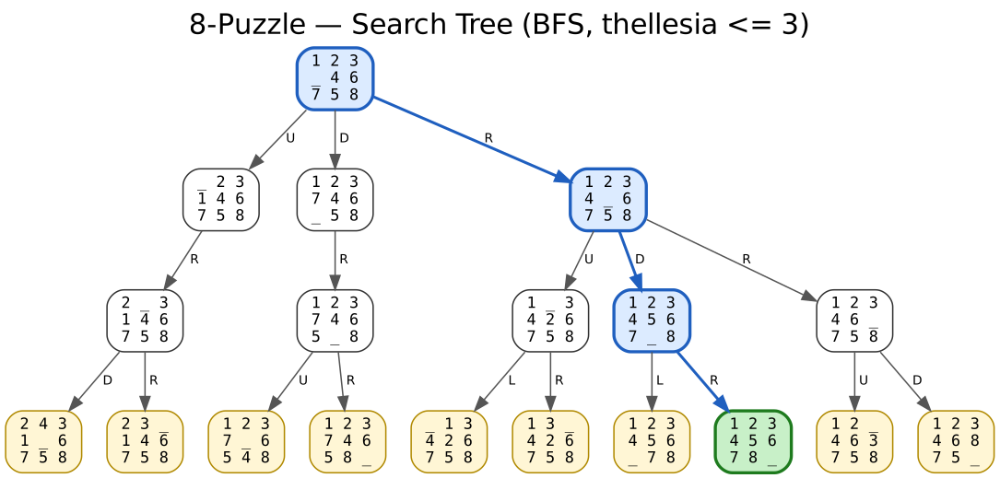

# Teknikat e Painformuara të Kërkimit (Uninformed Search)

**Detyra e parë semestrale – Inteligjenca Artificiale**
Universiteti i Prishtinës · Fakulteti i Inxhinierisë Elektrike dhe Kompjuterike

[](https://github.com/USERNAME/ai-uninformed-search/actions/workflows/tests.yml)


Implementim në Python i katër problemeve të detyrës, secili me modelim formal, reprezentim (variabla, domain, kufizime), objective function, analizë të landscape-it dhe algoritmin e kërkuar.

| # | Problemi | Algoritmi | Dokumentimi | Kodi |
|---|---|---|---|---|
| 1 | Social Golfers (32 lojtarë, 8 × 4) | **DFS + Backtracking** | [docs/1_social_golfers.md](docs/1_social_golfers.md) | [`social_golfers/`](ai_search/social_golfers/solver.py) |
| 2 | Sudoku Solver (Easy / Medium / Hard) | **BFS + Backtracking** | [docs/2_sudoku.md](docs/2_sudoku.md) | [`sudoku/`](ai_search/sudoku/solver.py) |
| 3 | Latin Square (n × n) | **IDDFS + Backtracking** | [docs/3_latin_square.md](docs/3_latin_square.md) | [`latin_square/`](ai_search/latin_square/solver.py) |
| 4 | Search Trees: 8-Puzzle, Missionaries & Cannibals, Rotating Workforce | BFS / DFS | [docs/4_search_trees.md](docs/4_search_trees.md) | [`search_trees/`](ai_search/search_trees/) |

## Rezultatet në një vështrim

| Problemi | Rezultati |
|---|---|
| Social Golfers | DFS gjen **5 javë** menjëherë (129 nyje); DFS me restarts gjen **6 javë**. Kufiri teorik: 10. Dokumentimi shpjegon pse DFS ngec (thrashing). |
| Sudoku | Të 9 enigmat (3 për nivel) zgjidhen; Hard (17 clues) nën 2 s me MRV. BFS e pastër i zgjidh Easy/Medium, por te Hard e tejkalon memorien. |
| Latin Square | `n ≤ 6` nën 1 s me IDDFS; symmetry breaking e zvogëlon punën për n = 5 nga 13.5 M në 4 914 nyje. |
| Search Trees | Tri pemë të gjeneruara automatikisht (PNG + DOT + TXT), me rrugën e zgjidhjes dhe degët e prera të shënuara. |

<p align="center">
  
</p>

## Struktura e projektit

```
ai-uninformed-search/
├── main.py                       # CLI – pika hyrëse për të gjitha detyrat
├── benchmarks.py                 # mat performancën, printon tabela Markdown
├── ai_search/
│   ├── stats.py                  # SearchStats: nyje, frontier, kohë
│   ├── social_golfers/solver.py  # 1. DFS + Backtracking
│   ├── sudoku/
│   │   ├── solver.py             # 2. BFS + Backtracking
│   │   └── puzzles.py            #    enigmat Easy/Medium/Hard + gjenerator
│   ├── latin_square/solver.py    # 3. IDDFS + Backtracking
│   └── search_trees/
│       ├── tree.py               # struktura e pemës + eksport Graphviz
│       ├── eight_puzzle.py
│       ├── missionaries.py
│       └── rotating_workforce.py
├── docs/                         # dokumentimi për secilin problem + figurat
└── tests/                        # 60 teste (pytest)
```

## Instalimi

Kërkohet **Python 3.10+**. Kodi kryesor nuk ka varësi të jashtme.

```bash
git clone https://github.com/USERNAME/ai-uninformed-search.git
cd ai-uninformed-search
python -m venv .venv
# Windows: .venv\Scripts\activate    |    Linux/macOS: source .venv/bin/activate
pip install -r requirements.txt       # vetëm pytest, për testet
```

Për figurat PNG të search trees: [Graphviz](https://graphviz.org/download/) (opsionale).

## Përdorimi

```bash
python main.py all                                  # ekzekuton të gjitha detyrat

python main.py golfers --weeks 5                    # 1. Social Golfers
python main.py golfers --max-weeks --restarts 10

python main.py sudoku --level easy                  # 2. Sudoku
python main.py sudoku --level hard --every
python main.py sudoku --generate medium --seed 7

python main.py latin --n 5                          # 3. Latin Square
python main.py latin --n 4 --full

python main.py trees                                # 4. Search Trees → docs/trees/
```

Çdo komandë ka `--help`. Çdo ekzekutim printon zgjidhjen, vlerën e objective function, statistikat (nyje të zgjeruara, nyje të prera, thellësia, frontier, koha) dhe madhësinë e landscape-it.

## Testet

```bash
python -m pytest            # 60 teste
python benchmarks.py        # rigjeneron tabelat e performancës
```

Testet verifikojnë që çdo zgjidhje i respekton kufizimet, që çdo Sudoku ka zgjidhje unike, që DFS vërteton mosekzistencën e zgjidhjes për instanca të vogla, si dhe zgjidhjen optimale të Missionaries & Cannibals (11 kalime).

## Konceptet kryesore

| Koncepti | Ku përdoret |
|---|---|
| **Variablat / Domain / Kufizimet** | Çdo problem modelohet si CSP (Constraint Satisfaction Problem) |
| **Objective function** | Numri i konflikteve (+ qeliza bosh) – zgjidhja ka `f = 0` |
| **Landscape** | Madhësia e hapësirës së kërkimit me dhe pa kufizime / symmetry breaking |
| **Backtracking** | Gjenerohen vetëm fëmijët e vlefshëm; degët pa dalje braktisen |
| **Symmetry breaking** | Social Golfers (java 1 fikse, grupe të renditura), Latin Square (forma e reduktuar) |
| **DFS vs BFS vs IDDFS** | Krahasimi i memories dhe i punës në tabelat e rezultateve |

## Autori

**Bleron Baftiu** – Inteligjenca Artificiale, 2026
