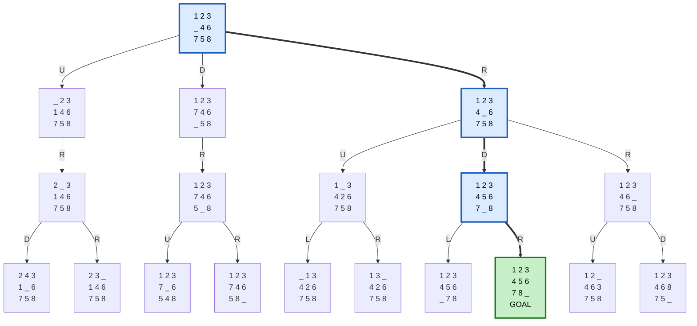

# Teknikat e Painformuara të Kërkimit (Uninformed Search)

**Detyra e parë semestrale – Inteligjenca Artificiale**

| # | Problemi | Algoritmi | Kodi | Dokumentimi |
|---|---|---|---|---|
| 1 | Social Golfers (32 lojtarë, 8 grupe × 4) | DFS + Backtracking | [`1_social_golfers.py`](1_social_golfers.py) | [docs/1_social_golfers.md](docs/1_social_golfers.md) |
| 2 | Sudoku Solver (Easy, Medium, Hard) | BFS + Backtracking | [`2_sudoku.py`](2_sudoku.py) | [docs/2_sudoku.md](docs/2_sudoku.md) |
| 3 | Latin Square (n × n) | IDDFS + Backtracking | [`3_latin_square.py`](3_latin_square.py) | [docs/3_latin_square.md](docs/3_latin_square.md) |
| 4 | Search Trees: 8-Puzzle, Missionaries & Cannibals, Rotating Workforce | BFS / DFS | [`4_search_trees.py`](4_search_trees.py) | [docs/4_search_trees.md](docs/4_search_trees.md) |

Për problemet 1–3, çdo dokument i mbulon kërkesat e detyrës me radhë: **modelimi**, **reprezentimi** (variablat, domain-i, kufizimet), **objective function**, **landscape** dhe **algoritmi**, plus rezultatet dhe pyetjet e mundshme.

## Ekzekutimi

Kërkohet Python 3.8+, pa paketa shtesë.

```bash
python 1_social_golfers.py        # 5 javë (ose: python 1_social_golfers.py 3)
python 2_sudoku.py                # të 9 enigmat (ose: python 2_sudoku.py hard)
python 3_latin_square.py          # kërkon n, p.sh. 5
python 4_search_trees.py          # printon të tri pemët
```

## Rezultatet në një vështrim

| Problemi | Rezultati |
|---|---|
| **Social Golfers** | Orar për 5 javë me `f(S) = 0` (161 nyje). Kufiri teorik është 10 javë; DFS ngec te java 6 për shkak të thrashing-ut (shpjeguar në dokumentim). |
| **Sudoku** | Të 9 enigmat zgjidhen me `f = 0`: Easy 46–52 nyje, Medium 96–215, Hard 3 723–17 438. |
| **Latin Square** | `n ≤ 6` zgjidhet nën 2 s; n = 5 me 4 914 nyje në 17 iteracione IDDFS. |
| **Search Trees** | 8-Puzzle: R → D → R (3 lëvizje). M&C: 11 kalime. RWS: orar 3-javor që respekton të gjitha kufizimet. |

## Search Tree: shembull

Pema e kërkimit për **8-Puzzle** (BFS, thellësia 3). Rruga blu është zgjidhja **R → D → R**. Të tri pemët (8-Puzzle, Missionaries & Cannibals, Rotating Workforce) janë te [docs/4_search_trees.md](docs/4_search_trees.md).



## Krahasimi i algoritmeve

| Algoritmi | Memoria | Complete | Optimal | Ku duket dobësia |
|---|---|---|---|---|
| **DFS** | `O(d)` | po (në hapësirë të fundme) | jo | Thrashing: gabimet e hershme zbulohen vonë (Social Golfers, java 6) |
| **BFS** | `O(b^d)` | po | po (kosto uniforme) | Radha rritet shpejt (Sudoku Hard: frontier deri në 908 gjendje) |
| **IDDFS** | `O(d)` | po | po (kosto uniforme) | Rivizitimi i niveleve të sipërme (Latin Square: 4 885 nga 4 914 nyje në iteracionet pa zgjidhje) |

Në të gjitha problemet, **backtracking-u** (gjenerohen vetëm gjendjet që respektojnë kufizimet) është arsyeja që hapësira të mëdha, nga 10^42 deri në 10^240, eksplorohen me vetëm disa qindra ose mijëra nyje.
