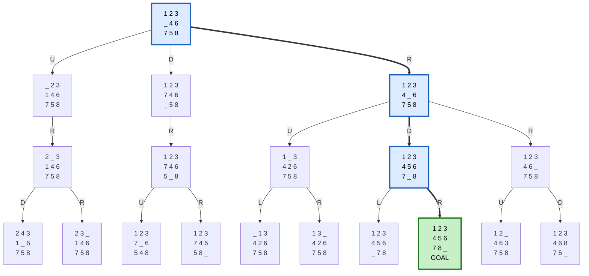
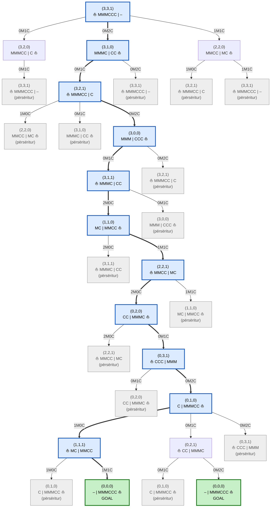
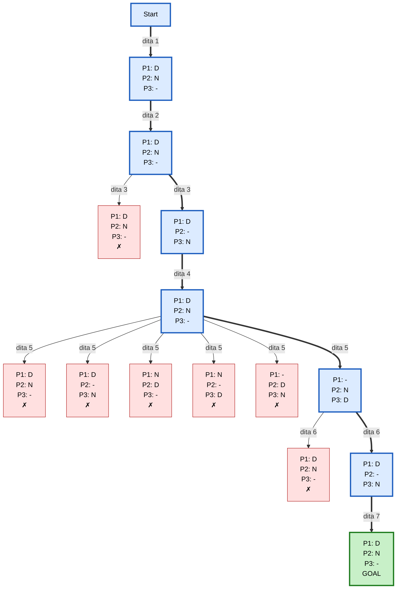

# 4. Search Trees

> Kodi: [`4_search_trees.py`](../4_search_trees.py)

Një **search tree** tregon si kërkimi i eksploron gjendjet:
- **rrënja** = gjendja fillestare
- **çdo degë** = një veprim (shënohet si `--veprimi-->`)
- **çdo nyje-fëmijë** = gjendja që del pas atij veprimi

Legjenda e diagrameve:

| Ngjyra | Kuptimi | Në daljen e programit |
|---|---|---|
| 🟩 jeshile | Gjendja qëllim | `[GOAL]` |
| 🟦 blu, me shigjeta të trasha | Rruga nga rrënja te qëllimi | – |
| ⬜ gri | Gjendje e parë më herët, nuk zgjerohet më | `[përsëritur]` |
| 🟥 e kuqe, me ✗ | Gjendje që shkel kufizimet, prerë nga backtracking-u | `[X]` |
| 🟪 vjollcë | Gjendje e zakonshme e zgjeruar ose e gjeneruar | – |

Diagramet janë në formatin **Mermaid**, të cilin GitHub e vizaton automatikisht. Nën secilin diagram është edhe pema si tekst, ashtu siç e printon `python 4_search_trees.py`.

Funksioni `printo()` e vizaton pemën rekursivisht: për çdo nyje printon etiketën dhe pastaj fëmijët e saj me `├──` dhe `└──`.

---

## 4.1 8-Puzzle

| Elementi | Përkufizimi |
|---|---|
| **Gjendja** | String me 9 karaktere, rresht pas rreshti; `0` = vendi bosh |
| **Fillimi** | `123046758`, pra `1 2 3 / _ 4 6 / 7 5 8` |
| **Qëllimi** | `123456780`, pra `1 2 3 / 4 5 6 / 7 8 _` |
| **Veprimet** | Lëviz vendin bosh: **U** (lart), **D** (poshtë), **L** (majtas), **R** (djathtas) |
| **Kostoja** | 1 për lëvizje |
| **Landscape** | `9! / 2 = 181 440` gjendje të arritshme; faktori i degëzimit 2–4 |

Pema ndërtohet me **BFS deri në thellësinë 3**. Lëvizja që e zhbën lëvizjen e mëparshme (p.sh. `D` pas `U`) nuk gjenerohet, që pema të mos ketë gjendje të kota.



<details>
<summary>Pema si tekst (dalja e programit)</summary>

```
123046758
├── --U--> 023146758
│   └── --R--> 203146758
│       ├── --D--> 243106758
│       └── --R--> 230146758
├── --D--> 123746058
│   └── --R--> 123746508
│       ├── --U--> 123706548
│       └── --R--> 123746580
└── --R--> 123406758
    ├── --U--> 103426758
    │   ├── --L--> 013426758
    │   └── --R--> 130426758
    ├── --D--> 123456708
    │   ├── --L--> 123456078
    │   └── --R--> 123456780 [GOAL]
    └── --R--> 123460758
        ├── --U--> 120463758
        └── --D--> 123468750
```

</details>

**Zgjidhja optimale:** R → D → R (3 lëvizje).

---

## 4.2 Missionaries and Cannibals

| Elementi | Përkufizimi |
|---|---|
| **Gjendja** | `(M, C, B)`: misionarë dhe kanibalë në bregun e majtë; `B = 1` kur varka është majtas. Në diagram: `MMMC \| CC ⛵` = bregu i majtë \| bregu i djathtë, ⛵ = ku është varka |
| **Fillimi → Qëllimi** | `(3, 3, 1)` → `(0, 0, 0)` |
| **Veprimet** | Varka bart `(m, c) ∈ {(1,0), (2,0), (0,1), (0,2), (1,1)}`, shënuar si `1M0C`, `0M2C` etj. |
| **Kufizimi** | Në asnjë breg misionarët (nëse ka) nuk mund të jenë më pak se kanibalët (`mc_valid`) |
| **Landscape** | `4 × 4 × 2 = 32` gjendje teorike, 20 të vlefshme, 16 të arritshme nga fillimi |

Pema ndërtohet me **BFS**. Gjendjet që shkelin kufizimin preren dhe nuk shfaqen. Gjendjet që janë parë më herët shënohen `[përsëritur]` dhe nuk zgjerohen.



<details>
<summary>Pema si tekst (dalja e programit)</summary>

```
(3, 3, 1)
├── --0M1C--> (3, 2, 0)
│   └── --0M1C--> (3, 3, 1) [përsëritur]
├── --0M2C--> (3, 1, 0)
│   ├── --0M1C--> (3, 2, 1)
│   │   ├── --1M0C--> (2, 2, 0) [përsëritur]
│   │   ├── --0M1C--> (3, 1, 0) [përsëritur]
│   │   └── --0M2C--> (3, 0, 0)
│   │       ├── --0M1C--> (3, 1, 1)
│   │       │   ├── --2M0C--> (1, 1, 0)
│   │       │   │   ├── --2M0C--> (3, 1, 1) [përsëritur]
│   │       │   │   └── --1M1C--> (2, 2, 1)
│   │       │   │       ├── --2M0C--> (0, 2, 0)
│   │       │   │       │   ├── --2M0C--> (2, 2, 1) [përsëritur]
│   │       │   │       │   └── --0M1C--> (0, 3, 1)
│   │       │   │       │       ├── --0M1C--> (0, 2, 0) [përsëritur]
│   │       │   │       │       └── --0M2C--> (0, 1, 0)
│   │       │   │       │           ├── --1M0C--> (1, 1, 1)
│   │       │   │       │           │   ├── --1M0C--> (0, 1, 0) [përsëritur]
│   │       │   │       │           │   └── --1M1C--> (0, 0, 0) [GOAL]
│   │       │   │       │           ├── --0M1C--> (0, 2, 1)
│   │       │   │       │           │   ├── --0M1C--> (0, 1, 0) [përsëritur]
│   │       │   │       │           │   └── --0M2C--> (0, 0, 0) [GOAL]
│   │       │   │       │           └── --0M2C--> (0, 3, 1) [përsëritur]
│   │       │   │       └── --1M1C--> (1, 1, 0) [përsëritur]
│   │       │   └── --0M1C--> (3, 0, 0) [përsëritur]
│   │       └── --0M2C--> (3, 2, 1) [përsëritur]
│   └── --0M2C--> (3, 3, 1) [përsëritur]
└── --1M1C--> (2, 2, 0)
    ├── --1M0C--> (3, 2, 1) [përsëritur]
    └── --1M1C--> (3, 3, 1) [përsëritur]
```

</details>

**Zgjidhja optimale ka 11 kalime.** Pema tregon dy rrugë të ndryshme me gjatësi 11, që ndryshojnë vetëm në dy kalimet e fundit:

```
(3,3,1) → (3,1,0) → (3,2,1) → (3,0,0) → (3,1,1) → (1,1,0) → (2,2,1)
        → (0,2,0) → (0,3,1) → (0,1,0) → (1,1,1) → (0,0,0)
```

---

## 4.3 Rotating Workforce Scheduling

Instanca e vogël, që pema të jetë e lexueshme:

- **3 punëtorë**, cikël **3-javor**: orari është matricë 3 × 7. Punëtori që e fillon në rreshtin 1 kalon në rreshtin 2 javën tjetër, pastaj në rreshtin 3, pastaj prapë në 1. Prandaj orari lexohet si një varg ciklik me 21 ditë.
- **Ndërrimet:** `D` (ditë), `N` (natë), `-` (pushim).

| | Kufizimi | Në kod |
|---|---|---|
| C1 | Çdo ditë: 1 × D, 1 × N, 1 × pushim | `permutations("DN-")` |
| C2 | Ndalohet natë → ditë (pa pushim pas natës) | `"ND" in x` |
| C3 | Maksimum 2 netë radhazi | `"NNN" in x` |
| C4 | Maksimum 4 ditë pune radhazi | `re.search("[DN]{5}", x)` |

| Elementi | Përkufizimi |
|---|---|
| **Variablat** | Ditët (kolonat) 1..7 |
| **Domain-i** | `3! = 6` permutacione të `{D, N, −}`, që e plotëson C1 automatikisht |
| **Veprimi** | Cakto ndërrimet e ditës së radhës për të 3 punëtorët |
| **Landscape** | `3^21 ≈ 10^10` pa kufizime; `6^7 = 279 936` me C1 |

Pema ndërtohet me **DFS + Backtracking**. Çdo nyje tregon ndërrimet e ditës për punëtorët P1 P2 P3 (p.sh. `D-N` = P1 ditë, P2 pushim, P3 natë). Degët `[X]` e shkelin një kufizim dhe preren menjëherë.



<details>
<summary>Pema si tekst (dalja e programit)</summary>

```
Start
└── --dita 1--> DN-
    └── --dita 2--> DN-
        ├── --dita 3--> DN- [X]
        └── --dita 3--> D-N
            └── --dita 4--> DN-
                ├── --dita 5--> DN- [X]
                ├── --dita 5--> D-N [X]
                ├── --dita 5--> ND- [X]
                ├── --dita 5--> N-D [X]
                ├── --dita 5--> -DN [X]
                └── --dita 5--> -ND
                    ├── --dita 6--> DN- [X]
                    └── --dita 6--> D-N
                        └── --dita 7--> DN- [GOAL]
```

</details>

Shembuj prerjesh:
- **Dita 3, `DN-` [X]**: P2 do të kishte `N N N`, 3 netë radhazi (C3).
- **Dita 5, `DN-` [X]**: P1 do të kishte `D D D D D`, 5 ditë pune radhazi (C4).

**Orari i gjetur:**

```
Java 1: D D D D - D D
Java 2: N N - N N - N
Java 3: - - N - D N -
```

## 4.4 Pyetje të mundshme

**Çka është search tree, dhe si dallon nga state space?** State space është bashkësia e të gjitha gjendjeve. Search tree është mënyra si një algoritëm i viziton ato, ku e njëjta gjendje mund të paraqitet disa herë (prandaj ka nyje `[përsëritur]`).

**Pse BFS për 8-Puzzle dhe M&C?** BFS gjen zgjidhjen me më pak hapa (optimale), sepse çdo veprim kushton 1.

**Pse DFS për Rotating Workforce?** Të gjitha zgjidhjet janë në thellësinë 7 (7 ditë), prandaj DFS + backtracking është më efikas.

**Pse 8-Puzzle ka vetëm 181 440 gjendje dhe jo 9! = 362 880?** Gjysma e renditjeve nuk mund të arrihen me lëvizje të ligjshme (varet nga pariteti i numrit të inversioneve).