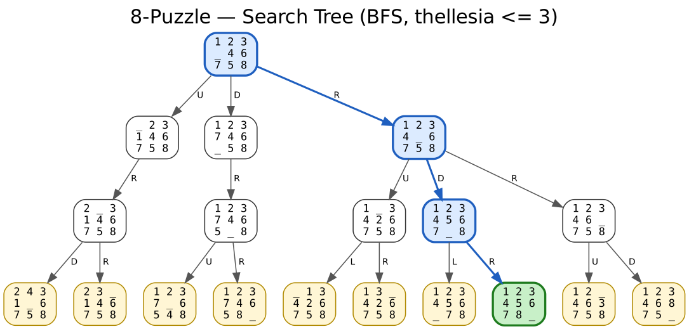
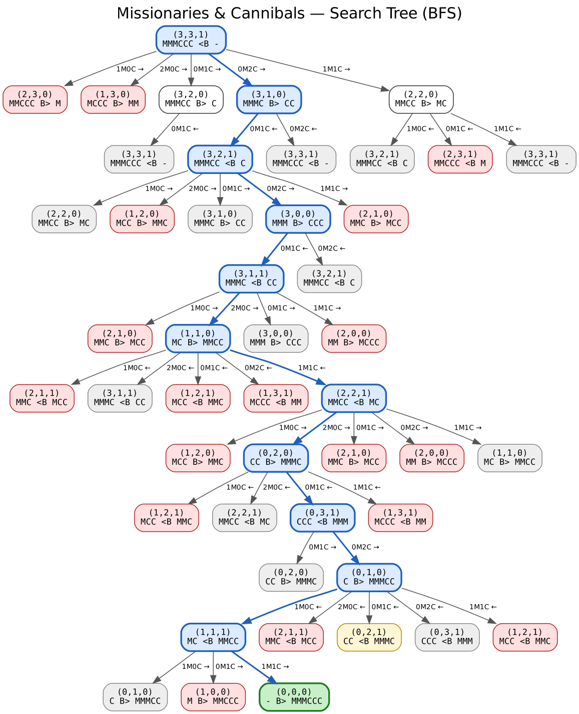
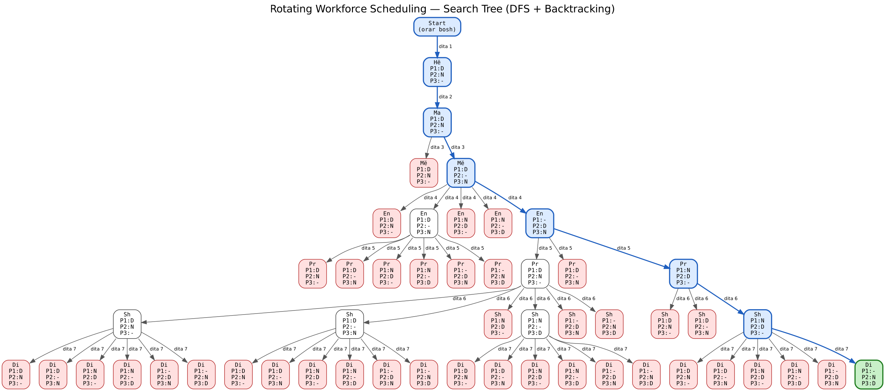

# 4. Search Trees

> Kodi: [`ai_search/search_trees/`](../ai_search/search_trees/) · Figurat: [`docs/trees/`](trees/)

Një **search tree** paraqet si kërkimi i eksploron gjendjet: rrënja është gjendja fillestare, çdo degë është një veprim dhe çdo nyje-fëmijë është gjendja që del pas atij veprimi. Pemët gjenerohen automatikisht me `python main.py trees` dhe ruhen si `.png` (Graphviz), `.dot` dhe `.txt`.

**Legjenda e ngjyrave**

| Ngjyra | Kuptimi |
|---|---|
| 🟦 blu (kornizë e trashë) | Rruga nga rrënja te qëllimi |
| 🟩 jeshile | Gjendja qëllim (goal) |
| 🟥 e kuqe | Gjendje që shkel kufizimet – prerë nga backtracking |
| ⬜ gri | Gjendje e përsëritur – nuk zgjerohet |
| 🟨 e verdhë | Frontier – e gjeneruar por e pazgjeruar (kufiri i thellësisë / kërkimi u ndal) |

---

## 4.1 8-Puzzle

| Elementi | Përkufizimi |
|---|---|
| Gjendja | Pozita e 8 pllakave dhe vendit bosh `_` në grid 3 × 3 |
| Fillimi | `1 2 3 / _ 4 6 / 7 5 8` |
| Qëllimi | `1 2 3 / 4 5 6 / 7 8 _` |
| Veprimet | Lëviz vendin bosh: **U** (lart), **D** (poshtë), **L** (majtas), **R** (djathtas) |
| Kostoja | 1 për lëvizje |
| Landscape | `9!/2 = 181 440` gjendje të arritshme; faktori i degëzimit 2–4 (mesatarisht ≈ 2.67) |

Pema ndërtohet me **BFS deri në thellësinë 3**. Lëvizja që e zhbën lëvizjen e mëparshme (p.sh. `U` pas `D`) nuk gjenerohet. Zgjidhja optimale: **R → D → R** (3 lëvizje). Kodi kontrollon edhe zgjidhshmërinë (numri i inversioneve duhet të jetë çift).



---

## 4.2 Missionaries and Cannibals

| Elementi | Përkufizimi |
|---|---|
| Gjendja | `(M, C, B)` – misionarë dhe kanibalë në bregun e majtë; `B = 1` varka majtas |
| Fillimi / Qëllimi | `(3, 3, 1)` → `(0, 0, 0)` |
| Veprimet | Varka bart `(m, c) ∈ {(1,0), (2,0), (0,1), (0,2), (1,1)}` |
| Kufizimi | Në asnjë breg misionarët (nëse > 0) nuk mund të jenë më pak se kanibalët |
| Landscape | `4 × 4 × 2 = 32` gjendje teorike, prej të cilave 20 të vlefshme dhe 16 të arritshme nga fillimi |

Pema ndërtohet me **BFS**. Gjendjet që shkelin kufizimin shfaqen me të kuqe, ndërsa ato të vizituara më parë me gri. Zgjidhja optimale ka **11 kalime**:

```
(3,3,1) → (3,1,0) → (3,2,1) → (3,0,0) → (3,1,1) → (1,1,0) → (2,2,1)
        → (0,2,0) → (0,3,1) → (0,1,0) → (1,1,1) → (0,0,0)
```



---

## 4.3 Rotating Workforce Scheduling (RWS)

Instanca e vogël (që pema të jetë e lexueshme):

* **3 punëtorë**, cikël **3-javor** – orari është matricë 3 × 7; punëtori që e fillon javën në rreshtin 1 kalon në rreshtin 2 javën tjetër, etj. (orari lexohet si varg ciklik me 21 ditë).
* **Ndërrimet**: `D` (ditë), `N` (natë), `-` (pushim).

| | Kufizimi |
|---|---|
| C1 | Kërkesa ditore: çdo ditë 1 × D, 1 × N, 1 × − |
| C2 | Ndalohet N → D (pa pushim pas natës) |
| C3 | Maksimum 4 ditë pune radhazi |
| C4 | Maksimum 2 netë radhazi |
| C5 | Blloku i punës zgjat të paktën 2 ditë |

| Elementi | Përkufizimi |
|---|---|
| Variablat | Ditët (kolonat) 1..7 |
| Domain-i | `3! = 6` permutacione të `{D, N, −}` – plotëson C1 automatikisht |
| Veprimi | Cakto permutacionin për ditën e radhës |
| Landscape | `3^21 ≈ 1.05 × 10^10` pa kufizime; `6^7 = 279 936` me C1 |

Pema ndërtohet me **DFS + Backtracking**: degët që shkelin C2–C5 shfaqen me të kuqe dhe nuk zgjerohen; nyjet e bardha janë zgjeruar, por nënpema e tyre dështoi (backtrack).



Orari i gjetur:

```
Java | Hë Ma Më En Pr Sh Di
---------------------------
  1  |  D  D  D  -  N  N  -
  2  |  N  N  -  D  D  D  N
  3  |  -  -  N  N  -  -  D
```

## 4.4 Ekzekutimi

```bash
python main.py trees              # gjeneron të tri pemët në docs/trees/
python main.py trees --depth 4    # 8-puzzle me thellësi më të madhe
```

Për PNG duhet [Graphviz](https://graphviz.org/download/) (`dot`). Pa të, ruhen vetëm `.dot` dhe `.txt`; skedari `.dot` mund të hapet edhe online, p.sh. në [GraphvizOnline](https://dreampuf.github.io/GraphvizOnline/).
